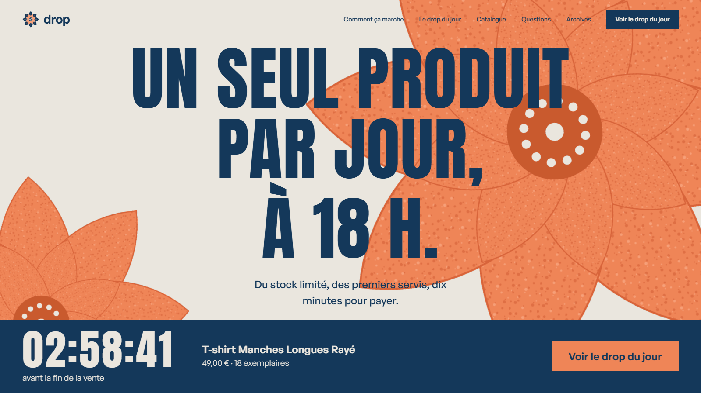
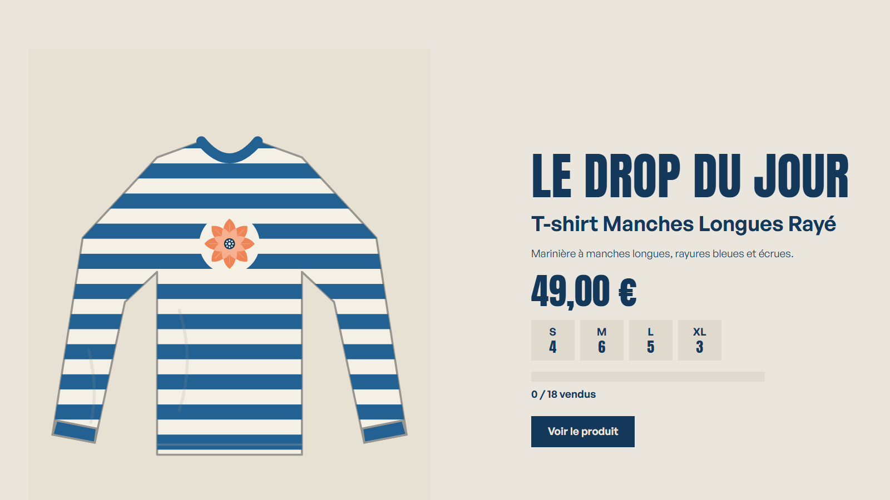
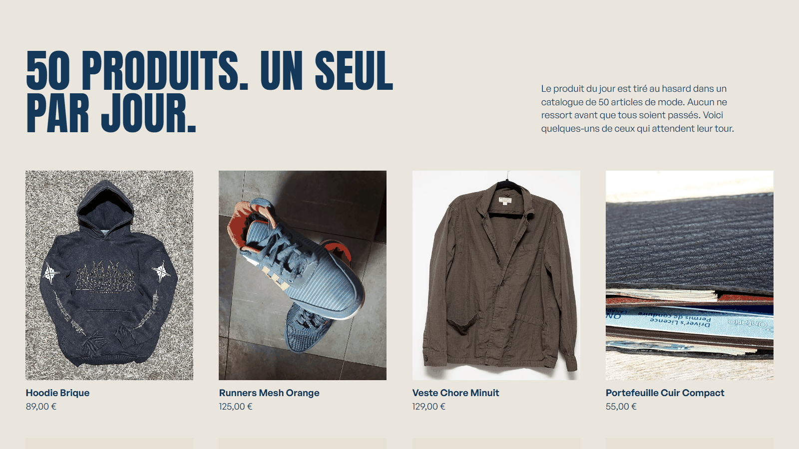
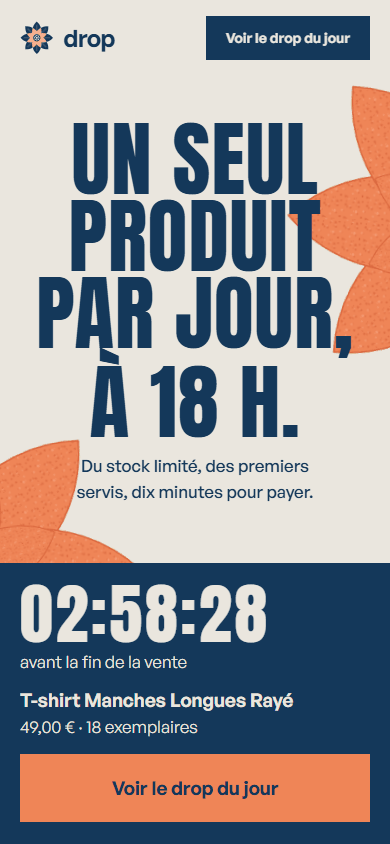

# Drop · Un produit, un jour, pas un de plus

🌐 **[drop.projectp.fr](https://drop.projectp.fr/)**

**Drop** est une boutique éphémère. Chaque jour, **un seul produit de mode** est mis en vente, en **stock limité**, à **18 h**. Un compte à rebours fait monter l'attente ; à l'ouverture, les premiers servis l'emportent. Quand le stock est épuisé ou que l'heure de vente est passée, la page ferme jusqu'au prochain drop.

Le produit du jour est **tiré au hasard** dans un catalogue de 50 articles, sans répétition tant que tous ne sont pas passés. Projet du **jour 26** du défi **30 jours, 30 projets** (Laravel, MySQL).

[](https://drop.projectp.fr/)

<p align="center">
  
  
</p>

<p align="center">
  
</p>

## Le scénario

> **Drop · Ouverture à 18 h 00**
> T-shirt Manches Longues Rayé · 18 exemplaires · 49 €
> ⏳ Ouverture dans 02:14:37

1. Avant l'ouverture, la page montre le produit, le stock annoncé et un compte à rebours. On peut s'inscrire pour être prévenu.
2. À 18 h, le bouton « Je le veux » s'active. Un clic **réserve un exemplaire pendant 10 minutes**, dans la taille choisie.
3. Pendant ces 10 minutes, l'acheteur finit sa commande (Stripe Checkout en mode test, ou paiement simulé en local).
4. Sans paiement dans le temps imparti, l'exemplaire **retourne dans le stock** pour le suivant.
5. Le stock se met à jour en direct. À zéro, la page affiche **sold out**, et les archives retiennent le temps qu'il a fallu (« Sold out en 3 min 12 s »).

## Fonctionnalités

- **Vitrine** : hero à titre géant, compteur en direct (horloge du serveur), produit du jour, catalogue, FAQ.
- **Tirage quotidien** : `drops:draw` crée le drop du jour (avant 18 h) et celui de demain, chaque heure, sans doublon. Ouverture à 18 h (heure de Paris), une heure de vente, stock tiré entre 10 et 30 exemplaires, réparti entre les tailles.
- **Catalogue de 50 produits** fictifs : 20 photos libres de droits, 30 illustrations dessinées dans le code (avec le logo).
- **Réservation de 10 minutes**, une seule réservation active par e-mail et par drop, stock par taille, limite de débit.
- **Paiement** : Stripe Checkout (mode test) avec webhook signé et idempotent, ou paiement simulé en local. **Fermé par défaut** (`DROP_PAYMENTS_ENABLED=false`).
- **E-mail de confirmation**, une seule fois par commande.
- **Liste d'attente** avant l'ouverture, **archives** des drops passés, **crédits photos**.
- **Back-office** `/admin/drops/create` (Basic Auth) pour créer un drop à la main : produit, photo, prix, tailles et stock, dates.
- **Test de charge** intégré : `php artisan drops:load-test`.

## Zéro survente

Le cœur du projet : ne **jamais** vendre plus que le stock, même quand des dizaines d'acheteurs cliquent sur le dernier exemplaire en même temps.

- La réservation décrémente le stock dans une **transaction** : verrou sur la ligne du drop (`lockForUpdate`), puis mise à jour conditionnelle `UPDATE drop_sizes SET reserved = reserved + 1 WHERE stock - reserved - sold > 0`.
- Les réservations expirées sont libérées par une tâche planifiée (chaque minute) **et** vérifiées à chaque nouvelle réservation, pour ne pas dépendre de la tâche.
- Le verrou du drop est pris **en premier partout** (réservation, libération, paiement) : sans cet ordre commun, MySQL renvoyait des deadlocks sous charge.
- Le serveur refuse toute réservation avant l'ouverture ou après la fermeture, même si on bidouille la page.

**Test de charge** (`php artisan drops:load-test --requests=200 --stock=20`) : 200 acheteurs, chacun dans son propre processus PHP, se disputent 20 exemplaires, puis paient. Résultat sur la base MySQL de production, trois essais sur trois : **exactement 20 commandes**, jamais une de plus.

## Critères de réussite

| Critère | État |
|---|:---:|
| 200 achats simultanés sur un stock de 20 donnent exactement 20 commandes | ✅ testé sur MySQL |
| Une réservation non payée revient dans le stock après 10 minutes | ✅ testé |
| Le bouton ne s'active pas avant l'heure d'ouverture, même en trichant côté navigateur | ✅ le serveur refuse |
| Un paiement réussi crée une commande et envoie l'e-mail, une seule fois (webhook idempotent) | ✅ testé en simulé et avec une signature de test |
| Choix de la taille avec un stock par taille (bonus) | ✅ |

Pas fait : file d'attente virtuelle, tirage au sort, temps réel avec Reverb, page de statistiques.

## Stack

Laravel 13 · PHP 8.4 · MySQL en production (SQLite en local) · Blade et JavaScript sans framework · Stripe Checkout (mode test) · tâches planifiées Laravel · Docker, hébergé sur Coolify.

Interface : Anton et General Sans, palette `#EAE6DE` / `#226192` / `#EF8557`.

## Lancer en local

Prérequis : PHP 8.4 et Composer.

```bash
composer install
cp .env.example .env
php artisan key:generate
touch database/database.sqlite
php artisan migrate --seed      # crée les tables et le catalogue de 50 produits
php artisan drops:draw          # tire le drop du jour et celui de demain
php artisan serve
```

Le site est sur http://127.0.0.1:8000. Pour le back-office, renseigne `ADMIN_PASSWORD` dans `.env`, puis ouvre `/admin/drops/create`. Les tâches planifiées (libération des réservations, tirage) se lancent avec `php artisan schedule:work`.

### Variables d'environnement propres à Drop

| Variable | Rôle |
|---|---|
| `ADMIN_USER` / `ADMIN_PASSWORD` | Identifiants du back-office. Sans mot de passe, il refuse tout accès. |
| `DROP_PAYMENTS_ENABLED` | `false` par défaut : le bouton « Payer » est désactivé et le serveur refuse les paiements. |
| `DROP_PAYMENT_MODE` | `simulated` (paiement factice, refusé si `APP_ENV=production`) ou `stripe`. |
| `STRIPE_SECRET`, `STRIPE_WEBHOOK_SECRET` | Clés de **test** Stripe. Webhook : `POST /stripe/webhook`, événement `checkout.session.completed`. |

## Tests

```bash
php artisan test
```

67 tests : statuts du drop, tirage sans répétition, stock entre 10 et 30, réservation (une par e-mail, stock jamais dépassé, expiration), paiement (flux simulé, double confirmation, webhook signé, rejeu, mauvais montant, paiement tardif), paiement bloqué, vitrine, header, illustrations.

Test de charge sur la base configurée : `php artisan drops:load-test --requests=200 --stock=20 --concurrency=20`. Sur SQLite, la concurrence est limitée : la preuve qui compte se fait sur MySQL.

## Déploiement

Un `Dockerfile` (Apache + PHP 8.4) et `docker/entrypoint.sh` : migrations avec réessais, catalogue, premier tirage, caches, puis le planificateur Laravel lancé en tâche de fond. Pour Coolify, on monte un volume sur `/var/www/html/storage/app/public` (photos envoyées depuis l'admin). Une instance est en ligne : **drop.projectp.fr**.

En production : `APP_ENV=production`, `DROP_PAYMENT_MODE=stripe`, les clés de test Stripe, un SMTP réel et un mot de passe d'admin fort. La page `/admin/load-test` est désactivée en production.

## Structure

| Dossier | Contenu |
|---|---|
| `app/Services/` | `ReservationService` (réservation, expiration), `OrderService` (commande idempotente), `DropDrawService` (tirage) |
| `app/Support/ProductArt.php` | Les 30 illustrations de produits en SVG |
| `app/Console/Commands/` | `drops:draw`, `drops:expire-reservations`, `drops:load-test` |
| `resources/views/` | Vitrine (`home`), page du drop, réservation, archives, back-office |
| `public/catalog/` | Photos du catalogue et `CREDITS.md` |
| `tests/` | Tests PHPUnit |
| `docs/` | Captures de ce README |

Le journal de bord complet (demandes, décisions, essais, échecs) est dans [`CLAUDE_CONTEXTE.md`](CLAUDE_CONTEXTE.md).

## Limites

- Les produits sont **fictifs** : c'est un site de démonstration. Le paiement est fermé, et Stripe n'a pas été essayé avec de vraies clés de test.
- Les illustrations sont des dessins plats, pas des photos du produit.
- L'envoi réel d'e-mails n'est pas testé (les messages vont dans les logs en local).

## Crédits

- **Photos** : Wikimedia Commons, licences CC0, domaine public, CC BY et CC BY-SA. Auteurs et sources : [`public/catalog/CREDITS.md`](public/catalog/CREDITS.md), ou la page `/credits` du site.
- **Illustrations et logo** : dessinés pour le projet, en SVG.
- **Polices** : [Anton](https://fonts.google.com/specimen/Anton) (Google Fonts) et [General Sans](https://www.fontshare.com/fonts/general-sans) (Fontshare).
